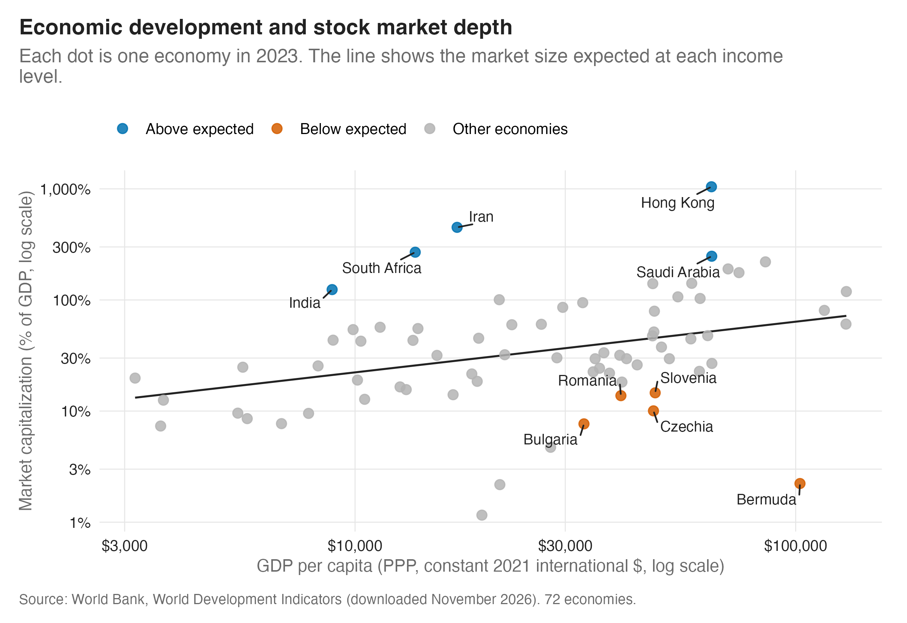

Why do economies with similar income levels have such different stock markets? This project uses World Bank data on 72 economies to establish the general relationship between income and stock market size, identify the economies that sit furthest from it, and examine what sets them apart.

[Read the project](page01.qmd){.btn .btn-primary}

{fig-alt="Scatter plot of GDP per capita against stock market capitalization as a percent of GDP, with the ten exceptions highlighted."}

## About the project

- **Data:** World Bank, World Development Indicators
- **Tools:** R, ggplot2, and Quarto
- **Course:** PSYC167 Data Visualization, Claremont McKenna College
- **Code and data:** [GitHub repository](https://github.com/adashti7/adashti7.github.io/tree/main/pages/project)
